

[English](./README.md) · **Bahasa Indonesia**

### Rumah engineering SIDIGS — satu platform untuk menjalankan seluruh sekolah.

Dari pendaftaran hingga rapor, presensi hingga kasir kantin: SIDIGS menghubungkan
yayasan, sekolah, guru, siswa, dan orang tua dalam satu ekosistem terpadu.

## 🏫 Apa yang kami bangun

SIDIGS adalah platform sekolah digital yang dipakai **yayasan, sekolah, dan keluarga** di seluruh Indonesia.
Organisasi ini menampung generasi berikutnya: layanan mandiri per domain di balik satu gateway,
dan satu aplikasi web dengan ruang kerja khusus untuk setiap peran.

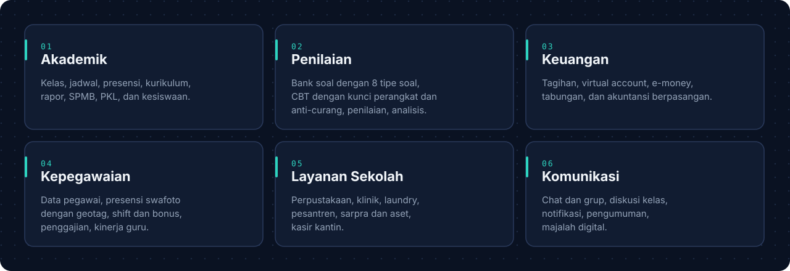

## 🧭 Arsitektur

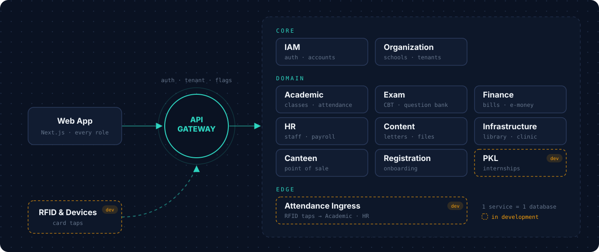

**Prinsip yang kami pegang**

- 🧩 **Satu domain, satu layanan, satu database** — setiap layanan memiliki datanya sendiri dan berkomunikasi lewat panggilan antarlayanan yang ditandatangani.
- 🚪 **Satu pintu masuk** — setiap request melewati API Gateway: identitas, tenant, izin akses, dan feature flag.
- 🔐 **Aman sejak awal** — identitas berbasis token (JWKS), izin per rute, kredensial terenkripsi, validasi input di setiap batas.
- 📱 **Mobile first** — sebagian besar pengguna memakai ponsel; setiap halaman harus berfungsi di lebar 375 px.
- 🧪 **Aturan yang teruji** — aturan uang, nilai, dan akses ada di modul kecil yang punya unit test.

## 🗂️ Repositori

<a href="https://github.com/sidigs-microservice/sidigs-web-app">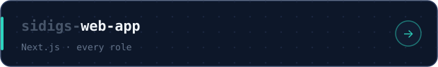</a>
<a href="https://github.com/sidigs-microservice/sidigs-api-gateway">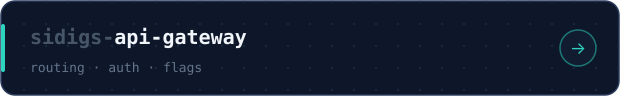</a>

<a href="https://github.com/sidigs-microservice/sidigs-attendance-ingress-service">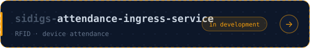</a>

<a href="https://github.com/sidigs-microservice/sidigs-iam-service">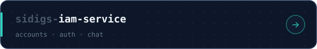</a>
<a href="https://github.com/sidigs-microservice/sidigs-organization-service">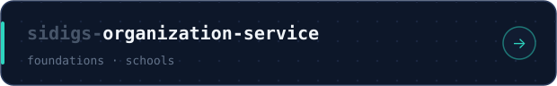</a>

<a href="https://github.com/sidigs-microservice/sidigs-academic-service">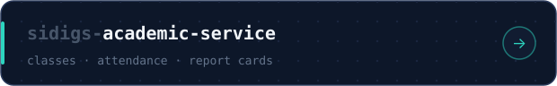</a>
<a href="https://github.com/sidigs-microservice/sidigs-exam-service">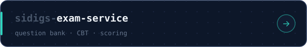</a>

<a href="https://github.com/sidigs-microservice/sidigs-finance-service">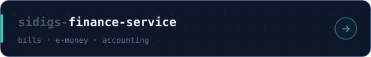</a>
<a href="https://github.com/sidigs-microservice/sidigs-hr-service">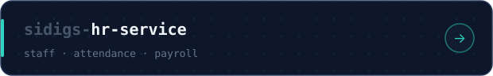</a>

<a href="https://github.com/sidigs-microservice/sidigs-content-service">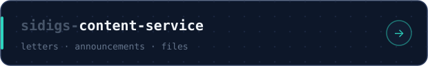</a>
<a href="https://github.com/sidigs-microservice/sidigs-infrastructure-service">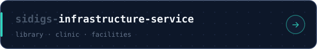</a>

<a href="https://github.com/sidigs-microservice/sidigs-canteen-service">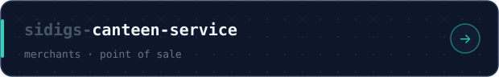</a>
<a href="https://github.com/sidigs-microservice/sidigs-registration-service">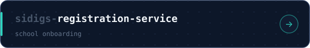</a>

<a href="https://github.com/sidigs-microservice/sidigs-pkl-service">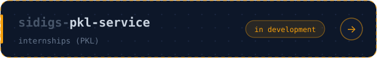</a>

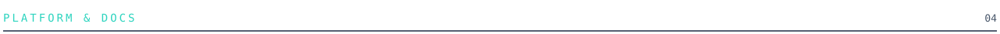

<a href="https://github.com/sidigs-microservice/sidigs-platform">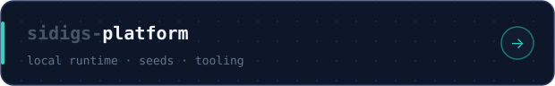</a>
<a href="https://github.com/sidigs-microservice/sidigs-service-template">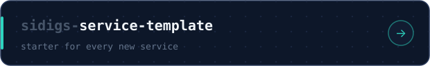</a>

<a href="https://github.com/sidigs-microservice/sidigs-architecture">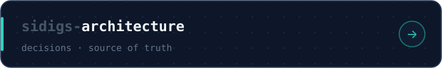</a>
<a href="https://github.com/sidigs-microservice/sidigs-api-collection">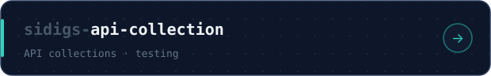</a>

## 🛠️ Teknologi

## 🔄 Cara kami bekerja

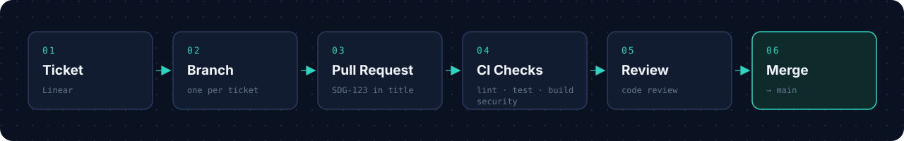

- 📋 **Linear** adalah tempat pekerjaan direncanakan dan dilacak. GitHub Issues tidak dipakai.
- 🔍 **Setiap perubahan direview** lewat pull request sebelum di-merge.
- 🤖 **GitHub Actions** menjalankan lint, test, build, dan pemeriksaan keamanan di setiap pull request.
- 🔒 **Tidak ada rahasia di kode** — konfigurasi datang dari environment, tidak pernah dari repositori.
- 📐 **Keputusan penting dicatat** di [`sidigs-architecture`](https://github.com/sidigs-microservice/sidigs-architecture).

---

[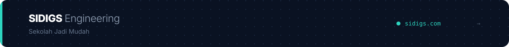](https://sidigs.com)
