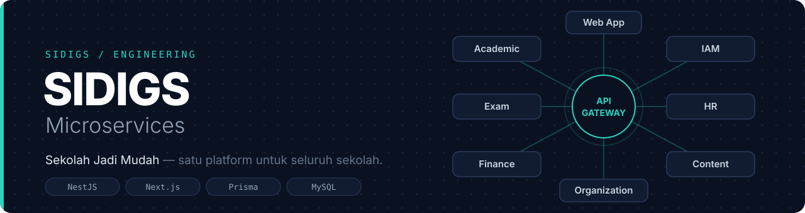
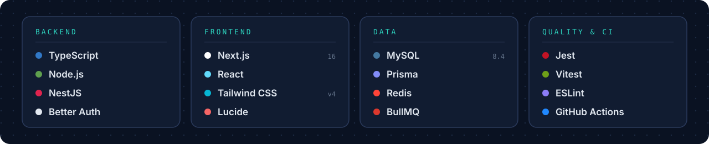

[English](./README.md) · **Bahasa Indonesia**

### Rumah engineering SIDIGS — satu platform untuk menjalankan seluruh sekolah.

Dari pendaftaran hingga rapor, presensi hingga kasir kantin: SIDIGS menghubungkan
yayasan, sekolah, guru, siswa, dan orang tua dalam satu ekosistem terpadu.

## 🏫 Apa yang kami bangun

SIDIGS adalah platform sekolah digital yang dipakai **yayasan, sekolah, dan keluarga** di seluruh Indonesia.
Organisasi ini menampung generasi berikutnya: layanan mandiri per domain di balik satu gateway,
dan satu aplikasi web dengan ruang kerja khusus untuk setiap peran.

## 🧭 Arsitektur

**Prinsip yang kami pegang**

- 🧩 **Satu domain, satu layanan, satu database** — setiap layanan memiliki datanya sendiri dan berkomunikasi lewat panggilan antarlayanan yang ditandatangani.
- 🚪 **Satu pintu masuk** — setiap request melewati API Gateway: identitas, tenant, izin akses, dan feature flag.
- 🔐 **Aman sejak awal** — identitas berbasis token (JWKS), izin per rute, kredensial terenkripsi, validasi input di setiap batas.
- 📱 **Mobile first** — sebagian besar pengguna memakai ponsel; setiap halaman harus berfungsi di lebar 375 px.
- 🧪 **Aturan yang teruji** — aturan uang, nilai, dan akses ada di modul kecil yang punya unit test.

## 🗂️ Repositori

<table>
<tr><th colspan="2" align="left">🌐 Front end &amp; gateway</th></tr>
<tr>
<td width="50%" valign="top"><a href="https://github.com/sidigs-microservice/sidigs-web-app"><b>sidigs-web-app</b></a> Aplikasi web dengan ruang kerja untuk setiap peran</td>
<td width="50%" valign="top"><a href="https://github.com/sidigs-microservice/sidigs-api-gateway"><b>sidigs-api-gateway</b></a> Routing, identitas, tenant, izin akses, feature flag</td>
</tr>
<tr><th colspan="2" align="left">🔑 Layanan inti</th></tr>
<tr>
<td width="50%" valign="top"><a href="https://github.com/sidigs-microservice/sidigs-iam-service"><b>sidigs-iam-service</b></a> Akun, autentikasi, notifikasi, chat</td>
<td width="50%" valign="top"><a href="https://github.com/sidigs-microservice/sidigs-organization-service"><b>sidigs-organization-service</b></a> Yayasan, sekolah, partner, branding</td>
</tr>
<tr><th colspan="2" align="left">🧩 Layanan domain</th></tr>
<tr>
<td width="50%" valign="top"><a href="https://github.com/sidigs-microservice/sidigs-academic-service"><b>sidigs-academic-service</b></a> Siswa, kelas, kurikulum, presensi, rapor</td>
<td width="50%" valign="top"><a href="https://github.com/sidigs-microservice/sidigs-exam-service"><b>sidigs-exam-service</b></a> Bank soal, runtime CBT, penilaian</td>
</tr>
<tr>
<td width="50%" valign="top"><a href="https://github.com/sidigs-microservice/sidigs-finance-service"><b>sidigs-finance-service</b></a> Tagihan, pembayaran, e-money, tabungan, akuntansi</td>
<td width="50%" valign="top"><a href="https://github.com/sidigs-microservice/sidigs-hr-service"><b>sidigs-hr-service</b></a> Pegawai, presensi staf, penggajian, kinerja</td>
</tr>
<tr>
<td width="50%" valign="top"><a href="https://github.com/sidigs-microservice/sidigs-content-service"><b>sidigs-content-service</b></a> Persuratan, pengumuman, dokumen, unggahan</td>
<td width="50%" valign="top"><a href="https://github.com/sidigs-microservice/sidigs-infrastructure-service"><b>sidigs-infrastructure-service</b></a> Sarpra, perpustakaan, klinik, laundry, pesantren</td>
</tr>
<tr>
<td width="50%" valign="top"><a href="https://github.com/sidigs-microservice/sidigs-canteen-service"><b>sidigs-canteen-service</b></a> Merchant dan kasir kantin</td>
<td width="50%" valign="top"><a href="https://github.com/sidigs-microservice/sidigs-registration-service"><b>sidigs-registration-service</b></a> Pendaftaran dan onboarding sekolah</td>
</tr>
<tr><th colspan="2" align="left">🧰 Platform &amp; dokumen</th></tr>
<tr>
<td width="50%" valign="top"><a href="https://github.com/sidigs-microservice/sidigs-platform"><b>sidigs-platform</b></a> Runtime lokal, konfigurasi, seed, alat developer</td>
<td width="50%" valign="top"><a href="https://github.com/sidigs-microservice/sidigs-service-template"><b>sidigs-service-template</b></a> Titik awal setiap layanan baru</td>
</tr>
<tr>
<td width="50%" valign="top"><a href="https://github.com/sidigs-microservice/sidigs-architecture"><b>sidigs-architecture</b></a> Keputusan arsitektur, sumber kebenaran</td>
<td width="50%" valign="top"><a href="https://github.com/sidigs-microservice/sidigs-api-collection"><b>sidigs-api-collection</b></a> Koleksi API untuk pengujian dan integrasi</td>
</tr>
</table>

## 🛠️ Teknologi

## 🔄 Cara kami bekerja

- 📋 **Linear** adalah tempat pekerjaan direncanakan dan dilacak. GitHub Issues tidak dipakai.
- 🔍 **Setiap perubahan direview** lewat pull request sebelum di-merge.
- 🤖 **GitHub Actions** menjalankan lint, test, build, dan pemeriksaan keamanan di setiap pull request.
- 🔒 **Tidak ada rahasia di kode** — konfigurasi datang dari environment, tidak pernah dari repositori.
- 📐 **Keputusan penting dicatat** di [`sidigs-architecture`](https://github.com/sidigs-microservice/sidigs-architecture).

---

