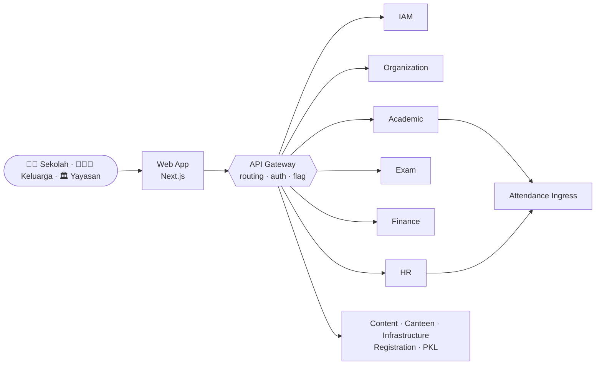

<div align="center">


[English](./README.md) · **Bahasa Indonesia**

### Rumah engineering SIDIGS — satu platform untuk menjalankan seluruh sekolah.

Dari pendaftaran hingga rapor, presensi hingga kasir kantin: SIDIGS menghubungkan
yayasan, sekolah, guru, siswa, dan orang tua dalam satu ekosistem terpadu.

[](https://sidigs.com)
[](https://github.com/sidigs-microservice/sidigs-architecture)
[](https://github.com/sidigs-microservice/sidigs-service-template)

</div>

---

## 🏫 Apa yang kami bangun

SIDIGS adalah platform sekolah digital yang dipakai **yayasan, sekolah, dan keluarga** di seluruh Indonesia.
Organisasi ini menampung generasi berikutnya: kumpulan layanan mandiri per domain di balik
satu gateway, dan satu aplikasi web dengan ruang kerja khusus untuk setiap peran.

<table>
<tr>
<td width="33%" valign="top">

**🎓 Akademik**<br/>
Kelas, jadwal, presensi, kurikulum, rapor, SPMB, PKL, kesiswaan.

</td>
<td width="33%" valign="top">

**📝 Penilaian**<br/>
Bank soal dengan 8 tipe soal, CBT dengan kunci perangkat dan anti-curang, penilaian dan analisis.

</td>
<td width="33%" valign="top">

**💰 Keuangan**<br/>
Tagihan, virtual account, e-money, tabungan, akuntansi berpasangan, buku besar kredit sekolah.

</td>
</tr>
<tr>
<td valign="top">

**👥 Kepegawaian**<br/>
Data pegawai, presensi dengan geo-tagging dan swafoto, shift dan bonus, penggajian, kinerja guru.

</td>
<td valign="top">

**🏢 Layanan sekolah**<br/>
Perpustakaan, klinik, laundry, pesantren, sarana prasarana dan aset, kasir kantin.

</td>
<td valign="top">

**💬 Komunikasi**<br/>
Chat dan grup, diskusi kelas, notifikasi, pengumuman, majalah digital.

</td>
</tr>
</table>

## 🧭 Arsitektur



**Prinsip yang kami pegang**

- 🧩 **Satu domain, satu layanan, satu database** — setiap layanan memiliki datanya sendiri dan berkomunikasi lewat panggilan antarlayanan yang ditandatangani.
- 🚪 **Satu pintu masuk** — setiap request melewati API Gateway: identitas, tenant, izin akses, dan feature flag.
- 🔐 **Aman sejak awal** — identitas berbasis token (JWKS), izin per rute, kredensial terenkripsi, validasi input di setiap batas.
- 📱 **Mobile first** — sebagian besar pengguna memakai ponsel; setiap halaman harus berfungsi di lebar 375 px.
- 🧪 **Aturan yang teruji** — aturan uang, nilai, dan akses ada di modul kecil yang punya unit test.

## 🗂️ Repositori

| Area | Repositori | Fungsi |
|---|---|---|
| 🌐 Front end | [`sidigs-web-app`](https://github.com/sidigs-microservice/sidigs-web-app) | Aplikasi web dengan ruang kerja per peran: administrasi, guru, siswa, orang tua, keuangan, yayasan, dan lainnya |
| 🚪 Edge | [`sidigs-api-gateway`](https://github.com/sidigs-microservice/sidigs-api-gateway) | Routing, identitas, tenant, izin akses, feature flag, rate limit |
| 🔑 Inti | [`sidigs-iam-service`](https://github.com/sidigs-microservice/sidigs-iam-service) | Akun, autentikasi, grup izin, notifikasi, chat |
| 🏛️ Inti | [`sidigs-organization-service`](https://github.com/sidigs-microservice/sidigs-organization-service) | Yayasan, sekolah, partner, branding, kebijakan presensi |
| 🎓 Domain | [`sidigs-academic-service`](https://github.com/sidigs-microservice/sidigs-academic-service) | Siswa, kelas, kurikulum, presensi, SPMB, rapor |
| 📝 Domain | [`sidigs-exam-service`](https://github.com/sidigs-microservice/sidigs-exam-service) | Bank soal, runtime CBT, penilaian |
| 💰 Domain | [`sidigs-finance-service`](https://github.com/sidigs-microservice/sidigs-finance-service) | Tagihan, pembayaran, e-money, tabungan, akuntansi |
| 👥 Domain | [`sidigs-hr-service`](https://github.com/sidigs-microservice/sidigs-hr-service) | Pegawai, presensi staf, penggajian, kinerja |
| 📰 Domain | [`sidigs-content-service`](https://github.com/sidigs-microservice/sidigs-content-service) | Persuratan, pengumuman, dokumen, unggahan |
| 🏢 Domain | [`sidigs-infrastructure-service`](https://github.com/sidigs-microservice/sidigs-infrastructure-service) | Sarpra, perpustakaan, klinik, laundry, pesantren |
| 🍱 Domain | [`sidigs-canteen-service`](https://github.com/sidigs-microservice/sidigs-canteen-service) | Merchant dan kasir kantin |
| 🧾 Domain | [`sidigs-registration-service`](https://github.com/sidigs-microservice/sidigs-registration-service) | Pendaftaran dan onboarding sekolah |
| 🏭 Domain | [`sidigs-pkl-service`](https://github.com/sidigs-microservice/sidigs-pkl-service) | Domain Praktik Kerja Lapangan (PKL) |
| 📡 Edge | [`sidigs-attendance-ingress-service`](https://github.com/sidigs-microservice/sidigs-attendance-ingress-service) | Penerimaan presensi dari RFID dan perangkat |
| 🧰 Platform | [`sidigs-platform`](https://github.com/sidigs-microservice/sidigs-platform) | Runtime lokal, konfigurasi, seed, dan alat developer |
| 🧱 Platform | [`sidigs-service-template`](https://github.com/sidigs-microservice/sidigs-service-template) | Titik awal setiap layanan baru |
| 📐 Dokumen | [`sidigs-architecture`](https://github.com/sidigs-microservice/sidigs-architecture) | Keputusan arsitektur dan sumber kebenaran |
| 🧪 Dokumen | [`sidigs-api-collection`](https://github.com/sidigs-microservice/sidigs-api-collection) | Koleksi API untuk pengujian dan integrasi |

## 🛠️ Teknologi

<div align="center">


</div>

## 🔄 Cara kami bekerja

```text
Tiket Linear  →  branch  →  pull request (judul memuat key Linear)  →  CI: lint · test · build · security  →  review  →  merge
```

- 📋 **Linear** adalah tempat pekerjaan direncanakan dan dilacak. GitHub Issues tidak dipakai.
- 🔍 **Setiap perubahan direview** lewat pull request sebelum di-merge.
- 🤖 **GitHub Actions** menjalankan lint, test, build, dan pemeriksaan keamanan di setiap pull request.
- 🔒 **Tidak ada rahasia di kode** — konfigurasi datang dari environment, tidak pernah dari repositori.
- 📐 **Keputusan penting dicatat** di [`sidigs-architecture`](https://github.com/sidigs-microservice/sidigs-architecture).

---

[](https://sidigs.com)
