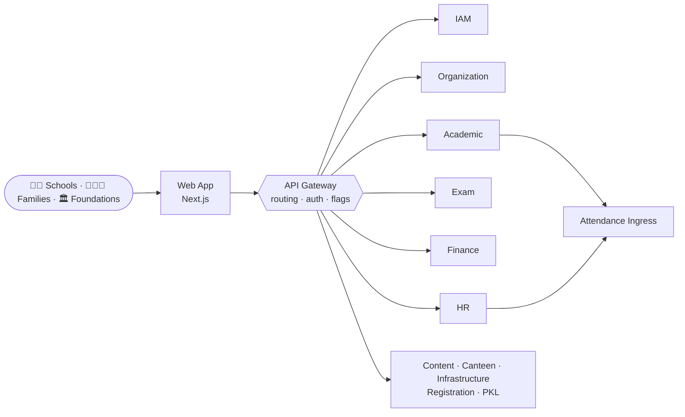

<div align="center">


### The engineering home of SIDIGS — one platform that runs a whole school.

From admissions to report cards, attendance to the canteen till: SIDIGS connects
foundations, schools, teachers, students and parents in one integrated ecosystem.

[](https://sidigs.com)
[](https://github.com/sidigs-microservice/sidigs-architecture)
[](https://github.com/sidigs-microservice/sidigs-service-template)

</div>

---

## 🏫 What we build

SIDIGS is a digital school platform used by **foundations, schools and families** across Indonesia.
This organization holds its next generation: a set of independent, domain-focused services
behind a single gateway, and one web app with a dedicated workspace for every role.

<table>
<tr>
<td width="33%" valign="top">

**🎓 Academic**<br/>
Classes, timetables, attendance, curriculum, report cards, admissions (SPMB), internships (PKL), student affairs.

</td>
<td width="33%" valign="top">

**📝 Assessment**<br/>
Question banks with 8 question types, CBT with device lock and anti-cheat, scoring and analytics.

</td>
<td width="33%" valign="top">

**💰 Finance**<br/>
Bills, virtual accounts, e-money, savings, double-entry accounting, school credit ledger.

</td>
</tr>
<tr>
<td valign="top">

**👥 People**<br/>
Staff records, attendance with geo-tagging and selfies, shifts and bonuses, payroll, teacher performance.

</td>
<td valign="top">

**🏢 School services**<br/>
Library, clinic, laundry, boarding school, facilities and assets, canteen point of sale.

</td>
<td valign="top">

**💬 Communication**<br/>
Chat and groups, class discussions, notifications, announcements, digital magazines.

</td>
</tr>
</table>

## 🧭 Architecture



**Principles we hold to**

- 🧩 **One domain, one service, one database** — services own their data and talk through signed service-to-service calls.
- 🚪 **A single front door** — every request passes the API Gateway: identity, tenant resolution, permissions and feature flags.
- 🔐 **Security by default** — token-based identity (JWKS), per-route permissions, encrypted credentials, validated input at every boundary.
- 📱 **Mobile first** — most of our users are on phones; every page must work at 375 px.
- 🧪 **Tested rules** — money, scoring and access rules live in small, unit-tested modules.

## 🗂️ Repositories

| Area | Repository | Purpose |
|---|---|---|
| 🌐 Front end | [`sidigs-web-app`](https://github.com/sidigs-microservice/sidigs-web-app) | Web app with a workspace per role: admin, teacher, student, parent, finance, foundation and more |
| 🚪 Edge | [`sidigs-api-gateway`](https://github.com/sidigs-microservice/sidigs-api-gateway) | Routing, identity, tenancy, permissions, feature flags, rate limits |
| 🔑 Core | [`sidigs-iam-service`](https://github.com/sidigs-microservice/sidigs-iam-service) | Accounts, authentication, permission groups, notifications, chat |
| 🏛️ Core | [`sidigs-organization-service`](https://github.com/sidigs-microservice/sidigs-organization-service) | Foundations, schools, partners, branding, attendance policy |
| 🎓 Domain | [`sidigs-academic-service`](https://github.com/sidigs-microservice/sidigs-academic-service) | Students, classes, curriculum, attendance, admissions, report cards |
| 📝 Domain | [`sidigs-exam-service`](https://github.com/sidigs-microservice/sidigs-exam-service) | Question banks, CBT runtime, scoring |
| 💰 Domain | [`sidigs-finance-service`](https://github.com/sidigs-microservice/sidigs-finance-service) | Billing, payments, e-money, savings, accounting |
| 👥 Domain | [`sidigs-hr-service`](https://github.com/sidigs-microservice/sidigs-hr-service) | Staff, staff attendance, payroll, performance |
| 📰 Domain | [`sidigs-content-service`](https://github.com/sidigs-microservice/sidigs-content-service) | Correspondence, announcements, documents, uploads |
| 🏢 Domain | [`sidigs-infrastructure-service`](https://github.com/sidigs-microservice/sidigs-infrastructure-service) | Facilities, library, clinic, laundry, boarding school |
| 🍱 Domain | [`sidigs-canteen-service`](https://github.com/sidigs-microservice/sidigs-canteen-service) | Merchants and canteen point of sale |
| 🧾 Domain | [`sidigs-registration-service`](https://github.com/sidigs-microservice/sidigs-registration-service) | School registration and onboarding |
| 🏭 Domain | [`sidigs-pkl-service`](https://github.com/sidigs-microservice/sidigs-pkl-service) | Internship (PKL) domain |
| 📡 Edge | [`sidigs-attendance-ingress-service`](https://github.com/sidigs-microservice/sidigs-attendance-ingress-service) | RFID and device attendance intake |
| 🧰 Platform | [`sidigs-platform`](https://github.com/sidigs-microservice/sidigs-platform) | Local runtime, config, seeds and developer tooling |
| 🧱 Platform | [`sidigs-service-template`](https://github.com/sidigs-microservice/sidigs-service-template) | Starting point for every new service |
| 📐 Docs | [`sidigs-architecture`](https://github.com/sidigs-microservice/sidigs-architecture) | Architecture decisions and the source of truth |
| 🧪 Docs | [`sidigs-api-collection`](https://github.com/sidigs-microservice/sidigs-api-collection) | API collections for testing and integration |

## 🛠️ Tech stack

<div align="center">


</div>

## 🔄 How we work

```text
Linear ticket  →  branch  →  pull request (title carries the Linear key)  →  CI: lint · test · build · security  →  review  →  merge
```

- 📋 **Linear** is where work is planned and tracked. GitHub Issues are not used.
- 🔍 **Every change is reviewed** through a pull request before it is merged.
- 🤖 **GitHub Actions** run lint, tests, builds and security checks on every pull request.
- 🔒 **No secrets in code** — configuration comes from the environment, never from the repository.
- 📐 **Significant decisions are written down** in [`sidigs-architecture`](https://github.com/sidigs-microservice/sidigs-architecture).

---

<div align="center">

**SIDIGS Engineering Team**

*Empowering schools through technology.*

[sidigs.com](https://sidigs.com)


</div>
