

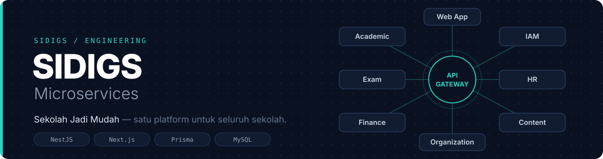

**English** · [Bahasa Indonesia](./README.id.md)

### The engineering home of SIDIGS — one platform that runs a whole school.

From admissions to report cards, attendance to the canteen till: SIDIGS connects
foundations, schools, teachers, students and parents in one integrated ecosystem.

## 🏫 What we build

SIDIGS is a digital school platform used by **foundations, schools and families** across Indonesia.
This organization holds its next generation: independent, domain-focused services behind a single
gateway, and one web app with a dedicated workspace for every role.

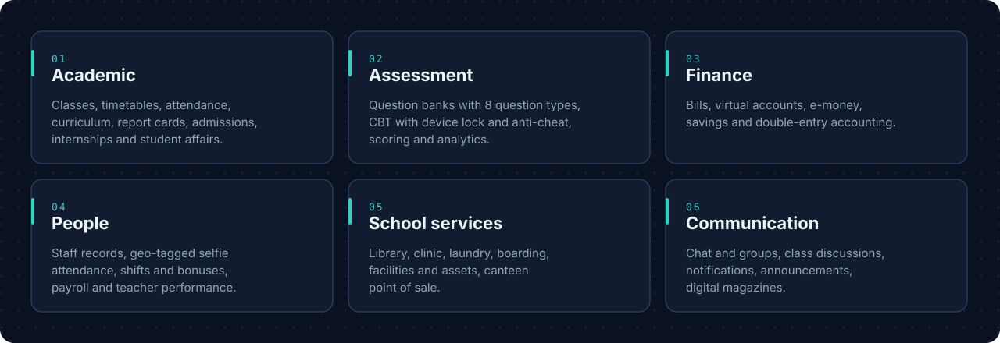

## 🧭 Architecture

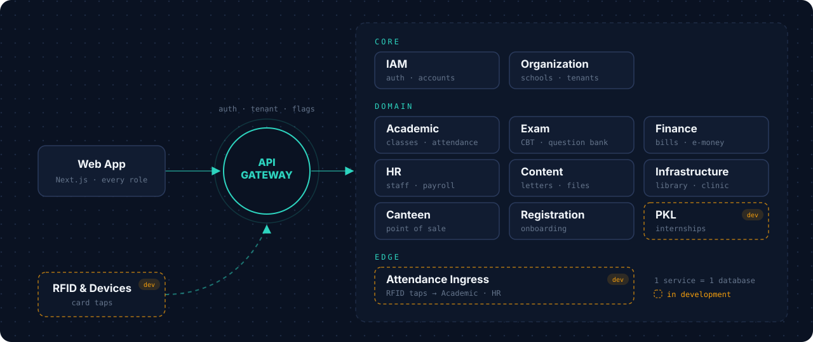

**Principles we hold to**

- 🧩 **One domain, one service, one database** — services own their data and talk through signed service-to-service calls.
- 🚪 **A single front door** — every request passes the API Gateway: identity, tenant resolution, permissions and feature flags.
- 🔐 **Security by default** — token-based identity (JWKS), per-route permissions, encrypted credentials, validated input at every boundary.
- 📱 **Mobile first** — most of our users are on phones; every page must work at 375 px.
- 🧪 **Tested rules** — money, scoring and access rules live in small, unit-tested modules.

## 🗂️ Repositories

<a href="https://github.com/sidigs-microservice/sidigs-web-app">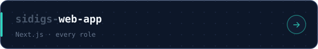</a>
<a href="https://github.com/sidigs-microservice/sidigs-api-gateway">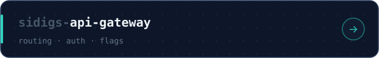</a>

<a href="https://github.com/sidigs-microservice/sidigs-attendance-ingress-service">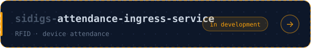</a>

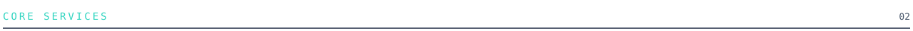

<a href="https://github.com/sidigs-microservice/sidigs-iam-service">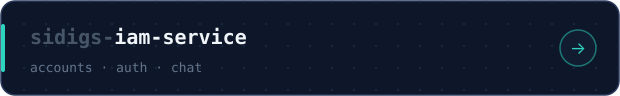</a>
<a href="https://github.com/sidigs-microservice/sidigs-organization-service">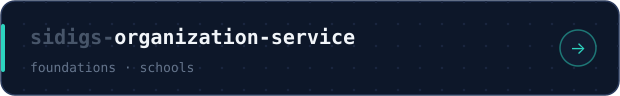</a>

<a href="https://github.com/sidigs-microservice/sidigs-academic-service">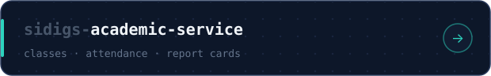</a>
<a href="https://github.com/sidigs-microservice/sidigs-exam-service">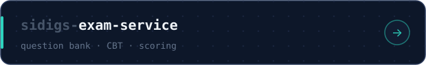</a>

<a href="https://github.com/sidigs-microservice/sidigs-finance-service">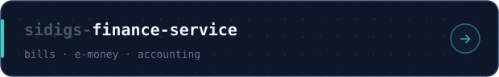</a>
<a href="https://github.com/sidigs-microservice/sidigs-hr-service">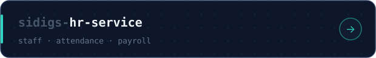</a>

<a href="https://github.com/sidigs-microservice/sidigs-content-service">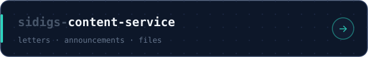</a>
<a href="https://github.com/sidigs-microservice/sidigs-infrastructure-service">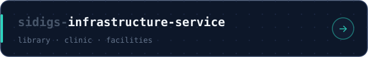</a>

<a href="https://github.com/sidigs-microservice/sidigs-canteen-service">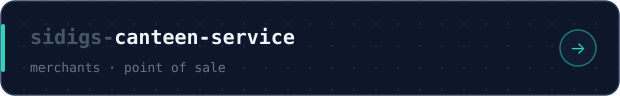</a>
<a href="https://github.com/sidigs-microservice/sidigs-registration-service">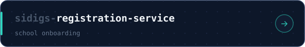</a>

<a href="https://github.com/sidigs-microservice/sidigs-pkl-service">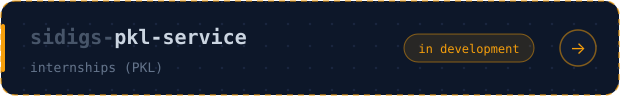</a>

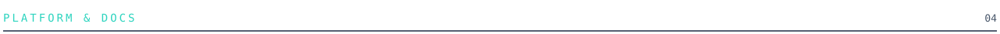

<a href="https://github.com/sidigs-microservice/sidigs-platform">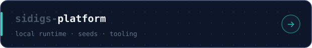</a>
<a href="https://github.com/sidigs-microservice/sidigs-service-template">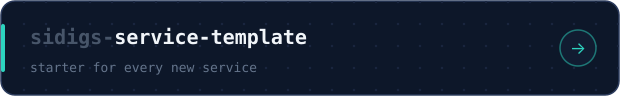</a>

<a href="https://github.com/sidigs-microservice/sidigs-architecture">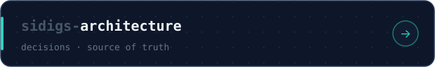</a>
<a href="https://github.com/sidigs-microservice/sidigs-api-collection">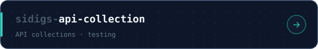</a>

## 🛠️ Tech stack

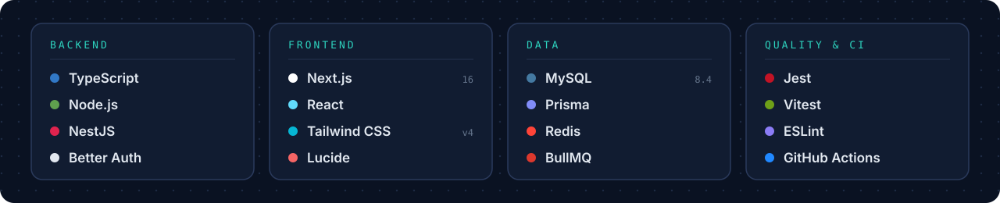

## 🔄 How we work

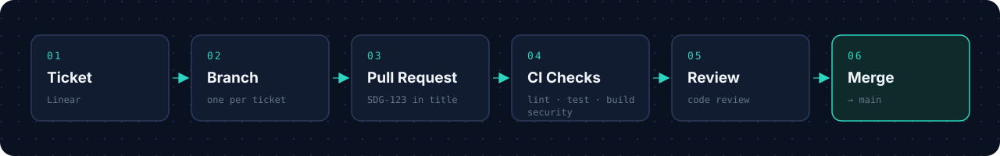

- 📋 **Linear** is where work is planned and tracked. GitHub Issues are not used.
- 🔍 **Every change is reviewed** through a pull request before it is merged.
- 🤖 **GitHub Actions** run lint, tests, builds and security checks on every pull request.
- 🔒 **No secrets in code** — configuration comes from the environment, never from the repository.
- 📐 **Significant decisions are written down** in [`sidigs-architecture`](https://github.com/sidigs-microservice/sidigs-architecture).

---

[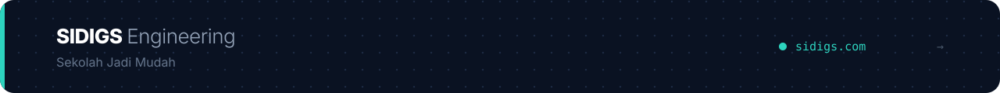](https://sidigs.com)
